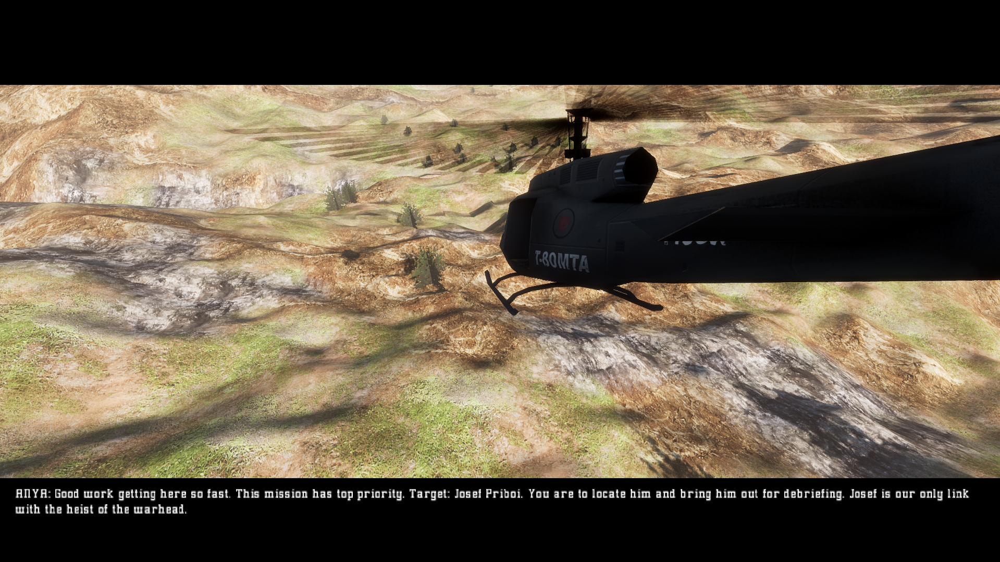
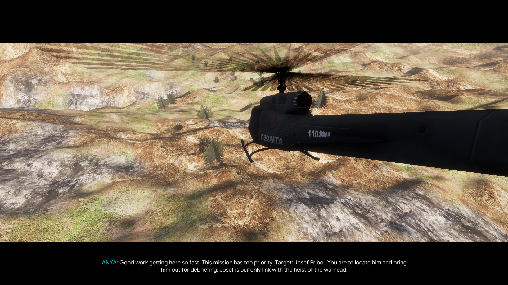

# HDSubMod

**HDSubMod** is a high-definition subtitle, typography, and localization enhancement mod for **Project I.G.I.** running on the **OpenIGI** engine.

It replaces the low-resolution retail bitmap cutscene font with crisp, modern TrueType vector typography, provides cinematic letterbox positioning, restores character-specific color themes, and adds full multi-language translation support.

---

## 📸 Before & After Comparison

### ❌ Before: Retail Low-Resolution Subtitles
> Low-resolution bitmap typography placed directly over the 3D scene with poor readability, awkward line wrapping, and no speaker differentiation.



---

### ✨ After: HDSubMod High-Definition Typography
> Crisp vector typography positioned cleanly in the cinematic letterbox bar, dynamic tactical speaker color coding, drop shadows for high contrast, and full multi-language support.



---

## ✨ Features

- **🎬 Cinematic Letterbox Placement**:
  - Subtitles are positioned neatly inside the bottom black letterbox bar, preventing any overlap with the 3D game scene.
- **🎨 Dynamic Character Speaker Themes**:
  - Speaker names are color-coded with distinct tactical colors and a drop shadow for high readability:
    - **ANYA**: Electric Cyan (`#00DCFF`)
    - **JONES**: Tactical Green (`#50E66E`)
    - **PRIBOI / JOSEF**: Warm Gold (`#FFD23C`)
    - **EKK**: Crimson Red (`#FF4B4B`)
    - **CAPT. HARRISON**: Amber (`#FFAA32`)
    - **Dialogue Body**: Pure White (`#FFFFFF`) with shadow
- **🌍 Multi-Language Localization**:
  - Full translations for all **176 cutscene dialogue lines** across all 14 missions, Intro, and Outro cutscenes.
  - **Supported Languages**:
    - **English** (Default)
    - **Sinhala (සිංහල)**
    - **Tamil (தமிழ்)**
    - **Hindi (हिन्दी)**
    - **Russian (Русский)**
    - **Spanish (Español)**
    - **German (Deutsch)**
- **🔤 Native TrueType Fonts & Advanced Typography**:
  - Powered by **Google Sans** & authentic typography across all languages:
    - `GoogleSans-Regular.ttf` & `GoogleSans-Bold.ttf` for Latin & Cyrillic (English, Russian, Spanish, German).
    - `fm-abhaya.ttf` with pre-composed visual glyph encoding for Sinhala script, ensuring 100% accurate Kombuwa positioning, ligatures, and vowel signs without shaper artifacts.
    - `bamini.ttf` with standard visual glyph encoding for Tamil script, ensuring flawless pre-positioned kombu (`ெ`, `ே`, `ை`), pulli virama dots, and conjuncts.
    - `kruti-dev-010.ttf` with classic typewriter encoding for Hindi (Devanagari) script, ensuring proper pre-base short 'i' matras (`ि`), half-letter conjuncts, and reph accents.
  - Dedicated multi-font speaker rendering guarantees that character names (`ANYA:`, `JONES:`, `PRIBOI:`) always render in clean Google Sans Latin with zero missing glyph boxes (`[][][][]`).
- **🎙️ Audio Speech Synchronization (Typewriter Reveal)**:
  - Subtitle text reveals progressively character-by-character in exact sync with cutscene voice audio, instead of popping the full sentence up front.
  - Character speaker tags (`ANYA:`, `JONES:`) appear immediately in their highlight color upon speech onset, followed by dialogue typing out smoothly.
  - Built-in layout stabilization prevents text jumping or line reflowing during reveal.
  - Smart diacritic snap ensures pre-base vowels (such as Sinhala Kombuwa `ෙ` and Hindi short-i `ि`) are never displayed without their base consonants.
  - Can be toggled on/off anytime via the OpenIGI Launcher mod settings (`sync_subtitles`).
- **⚙️ In-Game Mod Settings**:
  - Customize mod settings via the OpenIGI Launcher (`Settings` → `Mods` → `HDSubMod`):
    - **Language**: English, Sinhala, Tamil, Hindi, Russian, Spanish, German.
    - **Subtitle Audio Sync**: Toggle progressive speech-synced typewriter reveal vs. instant full sentence display.
- **🛡️ Full HUD Preservation**:
  - Implements `IHudIconSource` to guarantee that all in-game HUD elements (weapons, health bars, interaction timers, ammo, and radar) remain 100% intact.
  - Standard in-game gameplay dialogue forwards directly to OpenIGI's native HUD.

---

## 📂 Project Structure

```text
HDSubMod/
├── HDSubMod.cs               # Main mod source code & CustomHudPresenter
├── HDSubMod.csproj           # OpenIGI Modding SDK project file
├── README.md                 # This documentation
├── screenshots/              # Before and after in-game comparison images
│   ├── before.png
│   └── after.png
├── fonts/                    # High-definition TrueType fonts
│   ├── GoogleSans-Regular.ttf
│   ├── GoogleSans-Bold.ttf
│   ├── fm-abhaya.ttf
│   ├── bamini.ttf
│   └── kruti-dev-010.ttf
├── translations/             # Runtime translation dictionaries
│   ├── english.json
│   ├── sinhala.json
│   ├── tamil.json
│   ├── hindi.json
│   ├── russian.json
│   ├── spanish.json
│   └── german.json
└── detailed_subtitles/       # Human-readable side-by-side translation archives
    ├── english_detailed.json
    ├── sinhala_detailed.json
    ├── tamil_detailed.json
    ├── hindi_detailed.json
    ├── russian_detailed.json
    ├── spanish_detailed.json
    └── german_detailed.json
```

---

## 🚀 Building & Installation

### Requirements
- [.NET 10.0 SDK](https://dotnet.microsoft.com/)
- OpenIGI with `OpenIGI.Modding.Sdk` (v0.6.7 or newer)

### Build
Run the following command from the mod directory:

```bash
dotnet build
```

This compiles `HDSubMod.dll` and outputs the installable mod package into:
```
bin/Debug/net10.0/mod/
```

### Installation
1. Launch OpenIGI.
2. In the Launcher, go to **Settings** → **Mods**.
3. Enable **HDSubMod**.
4. Choose your preferred **Subtitle Language** from the dropdown menu.

---

## 🌐 Adding New Languages

To add a new language translation:
1. Create a new JSON file inside `translations/<language>.json`.
2. Map the original English subtitle string to your translated text:
   ```json
   {
     "ANYA: Good work getting here so fast.": "ANYA: <Your Translation Here>"
   }
   ```
3. Add the language to the `SubtitleLanguage` enum in `HDSubMod.cs` and recompile.

---

## 📄 License
MIT License.